<a href="https://github.com/udonsari0101">English</a> · <b>한국어</b>

<!-- 모든 이미지는 .github/scripts/profile_cards.py가 그려 매일 profile-cards 브랜치에 올립니다.
     stack·activity·contact 표시 사이의 블록은 자동 생성되므로 직접 고치지 말고 스크립트를 고치세요.
     <source srcset> URL에는 쉼표와 공백을 쓰지 마세요. 접이식 항목을 추가하면 건수도 고치세요. -->

<picture><source media="(prefers-color-scheme: dark)" srcset="https://raw.githubusercontent.com/udonsari0101/udonsari0101/profile-cards/hero-ko-dark.svg"></picture>

UNIST(울산과학기술원) 전기전자공학과에 재학 중입니다. 
소프트웨어 개발과 정보보안에 관심이 있으며, 다양한 분야의 프로젝트를 진행하고 있습니다. 개발 과정에서 AI를 적극적으로 활용합니다.

<!-- contact:start -->

<!-- contact:end -->

<!-- stack:start -->

<picture><source media="(prefers-color-scheme: dark)" srcset="https://raw.githubusercontent.com/udonsari0101/udonsari0101/profile-cards/stack/ko-dark-0.svg"></picture><picture><source media="(prefers-color-scheme: dark)" srcset="https://raw.githubusercontent.com/udonsari0101/udonsari0101/profile-cards/stack/ko-dark-1.svg"></picture><picture><source media="(prefers-color-scheme: dark)" srcset="https://raw.githubusercontent.com/udonsari0101/udonsari0101/profile-cards/stack/ko-dark-2.svg"></picture><picture><source media="(prefers-color-scheme: dark)" srcset="https://raw.githubusercontent.com/udonsari0101/udonsari0101/profile-cards/stack/ko-dark-3.svg"></picture>

<!-- stack:end -->

<!-- activity:start -->

<picture><source media="(prefers-color-scheme: dark)" srcset="https://raw.githubusercontent.com/udonsari0101/udonsari0101/profile-cards/tiles/ko-dark-0.svg"></picture><picture><source media="(prefers-color-scheme: dark)" srcset="https://raw.githubusercontent.com/udonsari0101/udonsari0101/profile-cards/tiles/ko-dark-1.svg"></picture><picture><source media="(prefers-color-scheme: dark)" srcset="https://raw.githubusercontent.com/udonsari0101/udonsari0101/profile-cards/contrib-ko-dark.svg"></picture>

<!-- activity:end -->

<b>경험 및 활동</b> ·&nbsp;2024년부터&nbsp;7건

지금까지 풀스택 웹 애플리케이션, Windows 데스크톱 소프트웨어, 네이티브 Android 애플리케이션, 자동화 도구를 개발하고 인프라를 구축했으며, 독자적으로 보안 분석도 해 왔습니다.

<!-- Ordered by start date (newest first). Entries with unknown months follow dated entries within the same year. -->
<table>
<tr>
<td valign="top" nowrap><samp>2026.11.14–</samp> <samp>2026.11.15</samp></td>
<td valign="top" width="1012"><b>CTF 대회 STAFF</b> 
2026 IST-TECH IT ARENA 
·&nbsp;CTF 대회 운영 및 현장 지원</td>
</tr>
<tr></tr>
<tr>
<td valign="top" nowrap><samp>2026.05.22</samp></td>
<td valign="top" width="1012"><b>CTF 문제 출제 및 대회 운영</b> 
UNIST HeXA 최마진 3회 
·&nbsp;CTF 문제 출제 및 대회 운영</td>
</tr>
<tr></tr>
<tr>
<td valign="top" nowrap><samp>2026.04–</samp> <samp>2026.12</samp></td>
<td valign="top" width="1012"><b>자율주행 개발자</b> 
유니주행차 · UNIST BTS(Brain to Society) 프로그램 
·&nbsp;ROS 2 기반 자율주행 소프트웨어 개발 
·&nbsp;Gazebo와 RViz를 활용한 시뮬레이션 환경 구축 
·&nbsp;AI 기반 자율주행 및 차량 제어 소프트웨어 개발</td>
</tr>
<tr></tr>
<tr>
<td valign="top" nowrap><samp>2026.01–</samp></td>
<td valign="top" width="1012"><b>해킹팀 팀장</b> 
UNIST 종합컴퓨팅 동아리 HeXA 
·&nbsp;웹 보안, 리버스 엔지니어링, CTF 활동</td>
</tr>
<tr></tr>
<tr>
<td valign="top" nowrap><samp>2025.07–</samp> <samp>2025.12</samp></td>
<td valign="top" width="1012"><b>풀스택 개발자</b> 
UNIST 동아리연합회 
·&nbsp;내부 활동용 웹 애플리케이션 단독 개발</td>
</tr>
<tr></tr>
<tr>
<td valign="top" nowrap><samp>2025.05–</samp> <samp>2026.02</samp></td>
<td valign="top" width="1012"><b>백엔드 개발자</b> 
ClubU · UNIST 동아리연합회 공식 웹사이트 
·&nbsp;데이터베이스 스키마 설계 및 REST API 개발 
·&nbsp;AWS 인프라, Docker 기반 배포 및 CI/CD 자동화</td>
</tr>
<tr></tr>
<tr>
<td valign="top" nowrap><samp>2024–</samp></td>
<td valign="top" width="1012"><b>프리랜서 소프트웨어 개발자</b> 
·&nbsp;풀스택 웹 애플리케이션 
·&nbsp;데스크톱 GUI 소프트웨어 
·&nbsp;맞춤형 자동화 도구 
·&nbsp;프론트엔드, 백엔드, API, 데이터베이스 개발 
·&nbsp;클라이언트 요구사항에 맞춘 소프트웨어 설계, 구현, 테스트, 납품</td>
</tr>
</table>

<b>보안 프로젝트</b> ·&nbsp;2025년부터&nbsp;2건

<table>
<tr>
<td valign="top" nowrap><samp>2026.09–</samp> <samp>2026.11</samp></td>
<td valign="top" width="1012"><b>IoT 보안 취약점 분석 및 개선</b> 
·&nbsp;IoT 기기 펌웨어 덤프·추출 및 리버스 엔지니어링 
·&nbsp;Android 앱 리버스 엔지니어링 및 웹 보안 취약점 분석 
·&nbsp;발견된 취약점 보완을 위한 신규 시스템 설계 및 구축</td>
</tr>
<tr></tr>
<tr>
<td valign="top" nowrap><samp>2025.09–</samp> <samp>2025.11</samp></td>
<td valign="top" width="1012"><b>모바일 앱 보안 취약점 분석</b> 
<a href="https://play.google.com/store/apps/details?id=com.wjddnwls7879.unistbab">밥먹어U</a> · UNIST 교내 식단 정보 앱 
·&nbsp;UNIST 구성원이 사용하는 실제 운영 모바일 앱 보안 점검 
·&nbsp;관리자 권한을 탈취할 수 있는 취약점 발견 및 재현 
·&nbsp;Google Play 누적 다운로드 1,000회 이상(2026년 기준)</td>
</tr>
</table>

<b>수상 및 대회</b> ·&nbsp;2025년부터&nbsp;8건

<table>
<tr>
<td valign="top" nowrap><samp>2026.11.07</samp></td>
<td valign="top" width="1012"><b>본선 진출</b> 
2026 UHCON 
·&nbsp;팀: HeXA</td>
</tr>
<tr></tr>
<tr>
<td valign="top" nowrap><samp>2026.09.13</samp></td>
<td valign="top" width="1012"><b>공동 2위</b> 
HSPACE SPACE WAR @ VIRGO (WEB) 
·&nbsp;팀: 우동사리</td>
</tr>
<tr></tr>
<tr>
<td valign="top" nowrap><samp>2026.09.11–09.12</samp></td>
<td valign="top" width="1012"><b>본선 진출</b> 
2026 HACKSIUM 
·&nbsp;팀: HeXA</td>
</tr>
<tr></tr>
<tr>
<td valign="top" nowrap><samp>2026.07.14</samp></td>
<td valign="top" width="1012"><b>3위</b> 
SECTOR CTF 
·&nbsp;팀: HeXA</td>
</tr>
<tr></tr>
<tr>
<td valign="top" nowrap><samp>2026.04.26</samp></td>
<td valign="top" width="1012"><b>공동 1위</b> 
HSPACE SPACE WAR @ TAURUS (PWN) 
·&nbsp;팀: 우동사리</td>
</tr>
<tr></tr>
<tr>
<td valign="top" nowrap><samp>2026.03.29</samp></td>
<td valign="top" width="1012"><b>공동 3위</b> 
HSPACE SPACE WAR @ ARIES (AI) 
·&nbsp;팀: 우동사리</td>
</tr>
<tr></tr>
<tr>
<td valign="top" nowrap><samp>2025.07.15–07.17</samp></td>
<td valign="top" width="1012"><b>본선 진출</b> 
2025 HACKSIUM 
·&nbsp;팀: UniKo</td>
</tr>
<tr></tr>
<tr>
<td valign="top" nowrap><samp>2025.06.01</samp></td>
<td valign="top" width="1012"><b>최우수상</b> 
UNIST HeXA 최마진 2회 
·&nbsp;팀: 우동사리</td>
</tr>
</table>

<b>동아리·자치기구 활동</b> ·&nbsp;2025년부터&nbsp;6건

<table>
<tr>
<td valign="top" nowrap><samp>2026&nbsp;1학기–</samp></td>
<td valign="top" width="1012"><b>전기전자공학과 학사국</b> 
UNIST 전기전자공학과 
·&nbsp;2026년 1학기부터 국원으로 활동</td>
</tr>
<tr></tr>
<tr>
<td valign="top" nowrap><samp>2026&nbsp;1학기–</samp></td>
<td valign="top" width="1012"><b>AFEE</b> 
Advanced and Fundamental of Electrical Engineering 
·&nbsp;UNIST 전기전자공학과 대표 학회 · 2026년 1학기부터 회원으로 활동</td>
</tr>
<tr></tr>
<tr>
<td valign="top" nowrap><samp>2025&nbsp;1학기–</samp></td>
<td valign="top" width="1012"><b>HeXA</b> 
UNIST 종합컴퓨팅 동아리 
·&nbsp;2025년 1학기부터 부원으로 활동, 2026년 1월부터 해킹팀 팀장</td>
</tr>
<tr></tr>
<tr>
<td valign="top" nowrap><samp>2025&nbsp;1학기–</samp> <samp>2026&nbsp;겨울학기</samp></td>
<td valign="top" width="1012"><b>UNIST 동아리연합회 (Club Union)</b> 
소통 및 협력부 
·&nbsp;2025년 2학기 차장</td>
</tr>
<tr></tr>
<tr>
<td valign="top" nowrap><samp>2025&nbsp;1학기–</samp> <samp>2025&nbsp;겨울학기</samp></td>
<td valign="top" width="1012"><b>9oormthon UNIV</b> 
교외 대학생 IT 연합동아리 · 부원</td>
</tr>
<tr></tr>
<tr>
<td valign="top" nowrap><samp>2025&nbsp;1학기</samp></td>
<td valign="top" width="1012"><b>피노키오 (Pinocchio)</b> 
UNIST 로봇동아리 · 부원</td>
</tr>
</table>

<b>관심 분야·역량</b> ·&nbsp;역량&nbsp;3개&nbsp;영역

**관심 분야**&ensp;정보보안 · 소프트웨어 공학 · 자동화 · 컴퓨터 시스템 · 인공지능

#### 소프트웨어 개발

- 풀스택 웹 개발
- 네이티브 Android 애플리케이션 개발
- Windows 데스크톱 GUI 개발
- 소프트웨어 아키텍처 및 시스템 설계
- REST API 설계, 연동, 문서화
- 데이터베이스 설계 및 스키마 모델링
- GUI 개발 및 UI/UX 구현
- 자동화 도구 및 맞춤형 소프트웨어 개발
- 테스트 자동화, 디버깅, 품질 보증
- 애플리케이션 패키징, 배포, 유지보수

#### 정보보안

- 웹 애플리케이션 보안 및 취약점 분석
- 리버스 엔지니어링 및 바이너리 분석
- Android 애플리케이션 보안
- 인증·인가 및 접근 제어
- 비즈니스 로직 보안
- 네트워크 트래픽 및 프로토콜 분석
- 보안 자동화
- CTF 문제 개발

**보안 도구**

- 리버스 엔지니어링: IDA Pro, Ghidra, JADX-GUI, x64dbg
- 웹·네트워크 보안: Burp Suite, mitmproxy

#### 인프라·시스템

- Linux 서버 관리
- Docker 기반 애플리케이션 배포
- 클라우드 인프라 및 셀프 호스팅
- CI/CD 및 개발 자동화

<b>학력</b> ·&nbsp;UNIST

<table>
<tr><td valign="top" nowrap><samp>2025.03–</samp></td><td valign="top" width="1012">UNIST(울산과학기술원) 전기전자공학과</td></tr>
</table>

