<b>English</b> · <a href="README.ko.md">한국어</a>

<!-- Every image is drawn by .github/scripts/profile_cards.py and published daily to the profile-cards branch.
     The stack, activity, and contact blocks between their markers are generated; edit the script instead.
     In <source srcset> URLs never use raw commas or spaces. When you add an entry to a drawer, update its count. -->

<picture><source media="(prefers-color-scheme: dark)" srcset="https://raw.githubusercontent.com/udonsari0101/udonsari0101/profile-cards/hero-en-dark.svg"></picture>

I'm an undergraduate student studying Electrical Engineering at UNIST (Ulsan National Institute of Science and Technology). 
I'm interested in software development and information security, and I work on projects across different fields. I actively use AI in my development workflow.

<!-- contact:start -->

<!-- contact:end -->

<!-- stack:start -->

<picture><source media="(prefers-color-scheme: dark)" srcset="https://raw.githubusercontent.com/udonsari0101/udonsari0101/profile-cards/stack/en-dark-0.svg"></picture><picture><source media="(prefers-color-scheme: dark)" srcset="https://raw.githubusercontent.com/udonsari0101/udonsari0101/profile-cards/stack/en-dark-1.svg"></picture><picture><source media="(prefers-color-scheme: dark)" srcset="https://raw.githubusercontent.com/udonsari0101/udonsari0101/profile-cards/stack/en-dark-2.svg"></picture><picture><source media="(prefers-color-scheme: dark)" srcset="https://raw.githubusercontent.com/udonsari0101/udonsari0101/profile-cards/stack/en-dark-3.svg"></picture>

<!-- stack:end -->

<!-- activity:start -->

<picture><source media="(prefers-color-scheme: dark)" srcset="https://raw.githubusercontent.com/udonsari0101/udonsari0101/profile-cards/tiles/en-dark-0.svg"></picture><picture><source media="(prefers-color-scheme: dark)" srcset="https://raw.githubusercontent.com/udonsari0101/udonsari0101/profile-cards/tiles/en-dark-1.svg"></picture><picture><source media="(prefers-color-scheme: dark)" srcset="https://raw.githubusercontent.com/udonsari0101/udonsari0101/profile-cards/contrib-en-dark.svg"></picture>

<!-- activity:end -->

<b>Experience &amp; Activities</b> ·&nbsp;7&nbsp;roles&nbsp;since&nbsp;2024

My work so far includes full-stack web applications, Windows desktop software, native Android applications, automation tools, infrastructure, and independent security analysis.

<!-- Ordered by start date (newest first). Entries with unknown months follow dated entries within the same year. -->
<table>
<tr>
<td valign="top" nowrap><samp>2026.11.14–</samp> <samp>2026.11.15</samp></td>
<td valign="top" width="1012"><b>CTF Competition Staff</b> 
2026 IST-TECH IT ARENA 
·&nbsp;CTF competition operations and on-site support</td>
</tr>
<tr></tr>
<tr>
<td valign="top" nowrap><samp>2026.05.22</samp></td>
<td valign="top" width="1012"><b>CTF Challenge Author &amp; Organizer</b> 
UNIST HeXA 최마진 3회 
·&nbsp;CTF challenge development and event operations</td>
</tr>
<tr></tr>
<tr>
<td valign="top" nowrap><samp>2026.04–</samp> <samp>2026.12</samp></td>
<td valign="top" width="1012"><b>Autonomous Driving Developer</b> 
유니주행차 · UNIST BTS (Brain to Society) Program 
·&nbsp;ROS 2-based autonomous driving software development 
·&nbsp;Simulation environment development using Gazebo&nbsp;and&nbsp;RViz 
·&nbsp;AI-based autonomous driving and vehicle control software</td>
</tr>
<tr></tr>
<tr>
<td valign="top" nowrap><samp>2026.01–</samp></td>
<td valign="top" width="1012"><b>Hacking Team Lead</b> 
HeXA · UNIST Comprehensive Computing Club 
·&nbsp;Web security, reverse engineering, and CTF activities</td>
</tr>
<tr></tr>
<tr>
<td valign="top" nowrap><samp>2025.07–</samp> <samp>2025.12</samp></td>
<td valign="top" width="1012"><b>Full-stack Developer</b> 
UNIST Club Union 
·&nbsp;Independently developed a web application for internal organizational activities</td>
</tr>
<tr></tr>
<tr>
<td valign="top" nowrap><samp>2025.05–</samp> <samp>2026.02</samp></td>
<td valign="top" width="1012"><b>Backend Developer</b> 
ClubU · UNIST Club Union Official Website 
·&nbsp;Database schema design and REST API development 
·&nbsp;AWS infrastructure, Docker-based deployment, and CI/CD automation</td>
</tr>
<tr></tr>
<tr>
<td valign="top" nowrap><samp>2024–</samp></td>
<td valign="top" width="1012"><b>Freelance Software Developer</b> 
·&nbsp;Full-stack web applications 
·&nbsp;Desktop GUI software 
·&nbsp;Custom automation tools 
·&nbsp;Frontend, backend, API, and database development 
·&nbsp;Software design, implementation, testing, and delivery based on client requirements</td>
</tr>
</table>

<b>Security Projects</b> ·&nbsp;4&nbsp;projects&nbsp;since&nbsp;2024

<table>
<tr>
<td valign="top" nowrap><samp>2026.09–</samp> <samp>2026.11</samp></td>
<td valign="top" width="1012"><b>IoT Security Assessment &amp; Remediation</b> 
·&nbsp;Firmware dumping, extraction, and reverse engineering 
·&nbsp;Android application reverse engineering and web vulnerability assessment 
·&nbsp;Design and implementation of a new system to address identified security weaknesses</td>
</tr>
<tr></tr>
<tr>
<td valign="top" nowrap><samp>2025.09–</samp> <samp>2025.11</samp></td>
<td valign="top" width="1012"><b>Mobile Application Security Assessment</b> 
<a href="https://play.google.com/store/apps/details?id=com.wjddnwls7879.unistbab">밥먹어U</a> · UNIST Campus Dining App 
·&nbsp;Assessed the security of a production mobile app used by the UNIST community 
·&nbsp;Identified and demonstrated a vulnerability enabling unauthorized administrator-level access 
·&nbsp;Google Play lists 1,000+ downloads (as of 2026)</td>
</tr>
<tr></tr>
<tr>
<td valign="top" nowrap><samp>2024.04–</samp> <samp>2025.05</samp></td>
<td valign="top" width="1012"><b>RFID/NFC Access Control Research</b> 
Independent Research 
·&nbsp;Studied MIFARE Classic 1K and NTAG213 tag characteristics, including UID formats 
·&nbsp;Tested Android NFC emulation and RFID reader compatibility 
·&nbsp;Examined security limitations of identifier-based authentication</td>
</tr>
<tr></tr>
<tr>
<td valign="top" nowrap><samp>2024.02–</samp> <samp>2026.07</samp></td>
<td valign="top" width="1012"><b>DRM Analysis &amp; Decryption Tool Development</b> 
Independent Project 
·&nbsp;Reverse-engineered DRM protection mechanisms and decryption workflows 
·&nbsp;Analyzed cryptographic components and library behavior 
·&nbsp;Developed custom decryption tools based on the analysis</td>
</tr>
</table>

<b>Awards &amp; Competitions</b> ·&nbsp;8&nbsp;results&nbsp;since&nbsp;2025

<table>
<tr>
<td valign="top" nowrap><samp>2026.11.07</samp></td>
<td valign="top" width="1012"><b>Finalist</b> 
2026 UHCON 
·&nbsp;Team: HeXA</td>
</tr>
<tr></tr>
<tr>
<td valign="top" nowrap><samp>2026.09.13</samp></td>
<td valign="top" width="1012"><b>Tied 2nd Place</b> 
HSPACE SPACE WAR @ VIRGO (WEB) 
·&nbsp;Team: 우동사리</td>
</tr>
<tr></tr>
<tr>
<td valign="top" nowrap><samp>2026.09.11–09.12</samp></td>
<td valign="top" width="1012"><b>Finalist</b> 
2026 HACKSIUM 
·&nbsp;Team: HeXA</td>
</tr>
<tr></tr>
<tr>
<td valign="top" nowrap><samp>2026.07.14</samp></td>
<td valign="top" width="1012"><b>3rd Place</b> 
SECTOR CTF 
·&nbsp;Team: HeXA</td>
</tr>
<tr></tr>
<tr>
<td valign="top" nowrap><samp>2026.04.26</samp></td>
<td valign="top" width="1012"><b>Tied 1st Place</b> 
HSPACE SPACE WAR @ TAURUS (PWN) 
·&nbsp;Team: 우동사리</td>
</tr>
<tr></tr>
<tr>
<td valign="top" nowrap><samp>2026.03.29</samp></td>
<td valign="top" width="1012"><b>Tied 3rd Place</b> 
HSPACE SPACE WAR @ ARIES (AI) 
·&nbsp;Team: 우동사리</td>
</tr>
<tr></tr>
<tr>
<td valign="top" nowrap><samp>2025.07.15–07.17</samp></td>
<td valign="top" width="1012"><b>Finalist</b> 
2025 HACKSIUM 
·&nbsp;Team: UniKo</td>
</tr>
<tr></tr>
<tr>
<td valign="top" nowrap><samp>2025.06.01</samp></td>
<td valign="top" width="1012"><b>Excellence Award (최우수상)</b> 
UNIST HeXA 최마진 2회 
·&nbsp;Team: 우동사리</td>
</tr>
</table>

<b>Organizations &amp; Memberships</b> ·&nbsp;7&nbsp;organizations&nbsp;since&nbsp;2025

<table>
<tr>
<td valign="top" nowrap><samp>Spring&nbsp;2026–</samp></td>
<td valign="top" width="1012"><b>UNIST Electrical Engineering Student Council</b> 
Bureau of Academic Affairs 
·&nbsp;Member</td>
</tr>
<tr>
<td valign="top" nowrap><samp>Spring&nbsp;2026–</samp></td>
<td valign="top" width="1012"><b>AFEE</b> 
Advanced and Fundamental of Electrical Engineering · UNIST Electrical Engineering's representative academic society 
·&nbsp;Member</td>
</tr>
<tr>
<td valign="top" nowrap><samp>Fall&nbsp;2025–</samp></td>
<td valign="top" width="1012"><b>JJeomNet</b> 
Nonprofit project community 
·&nbsp;Core</td>
</tr>
<tr>
<td valign="top" nowrap><samp>Spring&nbsp;2025–</samp></td>
<td valign="top" width="1012"><b>HeXA</b> 
UNIST Comprehensive Computing Club 
·&nbsp;Member; Hacking Team Lead since January 2026</td>
</tr>
<tr>
<td valign="top" nowrap><samp>Spring&nbsp;2025–</samp> <samp>Winter&nbsp;2026</samp></td>
<td valign="top" width="1012"><b>UNIST Club Union</b> 
Communications &amp; Cooperation Department 
·&nbsp;Member; Deputy Head of Department from Summer to Fall 2025</td>
</tr>
<tr>
<td valign="top" nowrap><samp>Spring&nbsp;2025–</samp> <samp>Winter&nbsp;2025</samp></td>
<td valign="top" width="1012"><b>9oormthon UNIV</b> 
Inter-university IT Community 
·&nbsp;Member</td>
</tr>
<tr>
<td valign="top" nowrap><samp>Spring&nbsp;2025–</samp> <samp>Winter&nbsp;2025</samp></td>
<td valign="top" width="1012"><b>Pinocchio</b> 
UNIST Robotics Club 
·&nbsp;Member</td>
</tr>
</table>

<b>Interests &amp; Skills</b> ·&nbsp;3&nbsp;skill&nbsp;areas

**Interests**&ensp;Information Security · Software Engineering · Automation · Computer Systems · Artificial Intelligence

#### Software Development

- Full-stack Web Development
- Native Android Application Development
- Windows Desktop GUI Development
- Software Architecture & System Design
- REST API Design, Integration & Documentation
- Database Design & Schema Modeling
- GUI Development & UI/UX Implementation
- Automation Tools & Custom Software Development
- Automated Testing, Debugging & Quality Assurance
- Application Packaging, Deployment & Maintenance

#### Information Security

- Web Application Security & Vulnerability Analysis
- Reverse Engineering & Binary Analysis
- Android Application Security
- Authentication, Authorization & Access Control
- Business Logic Security
- Network Traffic & Protocol Analysis
- Security Automation
- CTF Challenge Development

**Security tools**

- Reverse Engineering: IDA Pro, Ghidra, JADX-GUI, x64dbg
- Web & Network Security: Burp Suite, mitmproxy

#### Infrastructure & Systems

- Linux Server Administration
- Docker-based Application Deployment
- Cloud Infrastructure & Self-hosting
- CI/CD & Development Automation

<b>Education</b> ·&nbsp;UNIST

<table>
<tr><td valign="top" nowrap><samp>2025.03–</samp></td><td valign="top" width="1012">UNIST(Ulsan National Institute of Science and Technology) Department of Electrical Engineering</td></tr>
</table>

